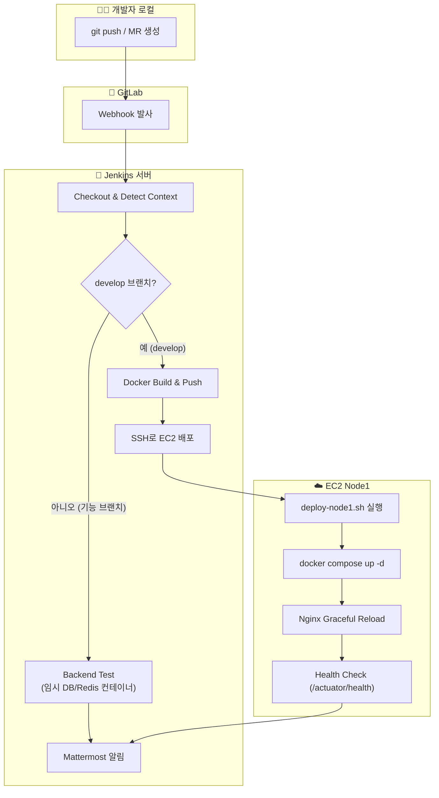

# 🚀 Yeoun CI/CD 파이프라인 구축 보고서

> **프로젝트**: S14P21B105 (Yeoun)
> **작업 기간**: 2026-03-12 ~ 2026-03-23
> **최종 상태**: ✅ CI 테스트 + CD 배포 + 헬스체크 + Mattermost 알림 **모두 정상 작동**

---

## 1. 최종 배포 아키텍처



---

## 2. 파이프라인 전체 흐름 (최종본)

### Stage 1: `Checkout & Detect Context`

| 항목 | 설명 |
|:---|:---|
| **이벤트 판별** | GitLab 플러그인 변수(`gitlabActionType`, `gitlabMergeRequestTitle`)로 MR vs Push 구분 |
| **브랜치명 추출** | `gitlabSourceBranch` → `gitlabBranch` → `BRANCH_NAME` → `GIT_BRANCH` → `git rev-parse` 순서로 Fallback |
| **변경 파일 감지** | `git diff HEAD~1 HEAD`로 `Backend/`, `Worker/`, `Infra/` 변경 여부를 각각 Boolean으로 저장 |
| **이미지 태그 생성** | `${BUILD_NUMBER}-${GIT_SHORT_SHA}` 형식 (예: `42-a1b2c3d`) |
| **네임스페이스 정규화** | DockerHub 대소문자 이슈 방지를 위해 `.toLowerCase()` 강제 적용 |

### Stage 2: `Backend Test (MR only)`

> **실행 조건**: `IS_DEVELOP == 'false'` (기능 브랜치) **또는** `EVENT_KIND == 'merge_request'`

1. 젠킨스 내부에 **임시 PostgreSQL(PostGIS) + Redis** 도커 컨테이너를 띄움
2. Jenkins Credentials에서 DB 계정 정보를 안전하게 꺼내옴
3. [application-local.properties.example](file:///c:/Users/SSAFY/Desktop/S14P21B105/Backend/src/main/resources/application-local.properties.example)을 복사하여 `application-ci.properties` 생성
4. 동적으로 생성된 DB/Redis IP 주소 + 모든 더미 환경변수를 `.env`에 주입
5. `export SPRING_PROFILES_ACTIVE=ci`로 프로필을 확실히 강제
6. `./mvnw test`로 통합 테스트 실행
7. 테스트 종료 후 임시 컨테이너 자동 삭제 (`docker rm -f`)

### Stage 3~5: `Build → Push → Deploy` (CD)

> **실행 조건**: `IS_DEVELOP == 'true'` (develop 브랜치에 코드가 도착했을 때만)

1. **Build**: [Backend/Dockerfile](file:///c:/Users/SSAFY/Desktop/S14P21B105/Backend/Dockerfile)로 도커 이미지 빌드
2. **Push**: DockerHub에 이미지 업로드
3. **Deploy**: SSH로 EC2(Node1)에 접속하여:
   - 최신 `Infra/` 폴더를 `scp`로 전송
   - `.env` 파일의 `API_IMAGE=` 태그만 `sed`로 교체
   - [deploy-node1.sh](file:///c:/Users/SSAFY/Desktop/S14P21B105/Infra/scripts/deploy-node1.sh) 실행 → `docker compose up -d` → Nginx Reload → Health Check
4. **Rollback**: 배포 실패 시 이전 이미지 태그로 자동 롤백

### Post: `Mattermost 알림`

모든 파이프라인 종료 후 성공/실패 여부를 Mattermost 채널에 자동 전송

---

## 3. 트러블슈팅 전체 기록

### 🔴 에러 #1: `MissingMethodException` — Groovy Sandbox 권한 에러
```
groovy.lang.MissingMethodException: No signature of method:
java.util.Collections$UnmodifiableMap.getProperty()
```

| 항목 | 내용 |
|:---|:---|
| **원인** | Jenkins의 Groovy Sandbox가 `params` Map에 직접 `.propertyName` 접근을 차단 |
| **해결** | `params` 접근 전 `containsKey()` 체크 로직으로 안전하게 우회 |

---

### 🔴 에러 #2: Docker Push 실패 — 대문자 네임스페이스
```
failed to do request: Head "https://KSS095/v2/yeoun-api/blobs/...":
dial tcp: lookup KSS095 on 127.0.0.53:53: server misbehaving
```

| 항목 | 내용 |
|:---|:---|
| **원인** | DockerHub 네임스페이스가 대문자(`KSS095`)면 Docker가 이를 커스텀 레지스트리 호스트명으로 오인 |
| **해결** | `.toLowerCase()` 적용하여 `kss095`로 강제 변환 |

---

### 🔴 에러 #3: Mattermost 알림 줄바꿈 깨짐
```
:white_check_mark: [S14P21B105] Jenkins 파이프라인 무사고 통과!\n이벤트: unknown\n...
```

| 항목 | 내용 |
|:---|:---|
| **원인** | `groovy.json.JsonOutput.toJson()`이 `\n`을 이중 이스케이프(`\\n`)하여 Mattermost가 문자 그대로 출력 |
| **해결** | `JsonOutput` 대신 직접 JSON 문자열을 조립하고, `.replace('\n', '\\n')`으로 한 번만 이스케이프 |

---

### 🔴 에러 #4: GitLab Webhook → Jenkins 401 Invalid token
```
HTTP ERROR 401 Invalid token
URI: /project/yeoun-cicd-develop
```

| 항목 | 내용 |
|:---|:---|
| **원인** | Jenkins에 설정된 Secret Token과 GitLab Webhook에 등록된 Token이 불일치 |
| **해결** | Jenkins 구성 → Build Triggers → Advanced → `Generate` 클릭 → 새 토큰을 GitLab Webhook에 재등록 |

---

### 🔴 에러 #5: Jenkins Credentials 미등록
```
ERROR: Could not find credentials entry with ID 'ci-postgres-db'
```

| 항목 | 내용 |
|:---|:---|
| **원인** | 보안 리팩토링으로 하드코딩 제거 후, Jenkins UI에 Credentials를 아직 생성하지 않음 |
| **해결** | Jenkins → Credentials → `Secret text` 타입으로 4개 등록 (`ci-postgres-db`, `ci-postgres-user`, `ci-postgres-password`, `mattermost-webhook-url`) |

---

### 🔴 에러 #6: CI 테스트 스테이지 Skip (when 조건 불일치)
```
Stage "Backend Test (MR only)" skipped due to when conditional
```

| 항목 | 내용 |
|:---|:---|
| **원인** | MR이 열린 상태에서 Push 이벤트가 들어오면 `EVENT_KIND == 'push'`로 판정되어 테스트 블록의 `merge_request` 조건을 통과하지 못함 |
| **해결** | `when` 조건을 [(EVENT_KIND == 'merge_request' \|\| IS_DEVELOP == 'false')](file:///c:/Users/SSAFY/Desktop/S14P21B105/Backend/src/main/java/com/yeoun/YeounApplication.java#12-15)로 변경하여, **기능 브랜치의 모든 Push도 CI 테스트 대상에 포함** |

---

### 🔴 에러 #7: Spring Boot `activeProfiles = []` — 프로필 미적용
```
activeProfiles = []
Failed to load ApplicationContext
```

| 항목 | 내용 |
|:---|:---|
| **원인** | Maven Surefire 플러그인이 `-Dspring.profiles.active=ci` 옵션을 JVM 자식 프로세스에 전달하지 않음 |
| **해결** | `-D` 옵션 대신 `export SPRING_PROFILES_ACTIVE=ci`로 셸 환경변수에 직접 주입하여 Surefire가 무시하지 못하도록 강제 |

---

### 🔴 에러 #8: Spring Boot Bean 생성 실패 — 환경변수 누락
```
Error creating bean with name '...'
```

| 항목 | 내용 |
|:---|:---|
| **원인** | 백엔드에 새로 추가된 기능(Kafka, AWS S3, Mail, OAuth)의 필수 환경변수가 CI 테스트 환경의 `.env`에 빠져있었음 |
| **해결** | Jenkinsfile의 `.env` 생성 블록에 모든 필수 더미 변수 풀세트 주입 (`KAFKA_BOOTSTRAP_SERVERS`, `AWS_*`, `MAIL_*`, `GOOGLE_CLIENT_ID` 등) |

---

### 🔴 에러 #9: Postgres `environment` 블록 삭제로 인한 DB 인증 실패

| 항목 | 내용 |
|:---|:---|
| **원인** | 다른 AI 도구의 권고로 [docker-compose.yml](file:///c:/Users/SSAFY/Desktop/S14P21B105/Infra/docker/node1/docker-compose.yml)에서 Postgres `environment` 블록을 제거 → 컨테이너가 비밀번호 없이 초기화됨 |
| **해결** | `environment` 블록(`POSTGRES_USER`, `POSTGRES_PASSWORD`, `POSTGRES_DB`) 복원 |

---

### 🔴 에러 #10: Kafka 서버 주소 미해석 → 서버 부팅 실패
```
Caused by: org.apache.kafka.common.config.ConfigException:
No resolvable bootstrap urls given in bootstrap.servers
```

| 항목 | 내용 |
|:---|:---|
| **원인** | [application-prod.properties](file:///c:/Users/SSAFY/Desktop/S14P21B105/Backend/src/main/resources/application-prod.properties)의 기본값이 `kafka:9092`인데, Node1 도커망에 Kafka 컨테이너가 없음 |
| **해결** | EC2 Node1의 `.env` 파일에 `KAFKA_BOOTSTRAP_SERVERS=<Node2 실제 IP>:9092` 명시 |

---

### 🔴 에러 #11: Health Check 실패 → 배포 자동 롤백
```
Health check failed after 30 attempts: http://localhost/actuator/health
```

| 항목 | 내용 |
|:---|:---|
| **원인** | Spring Boot Actuator 의존성을 제거한 상태에서 `/actuator/health` 엔드포인트가 404를 반환 |
| **해결** | [YeounApplication.java](file:///c:/Users/SSAFY/Desktop/S14P21B105/Backend/src/main/java/com/yeoun/YeounApplication.java)에 경량 [HealthCheckController](file:///c:/Users/SSAFY/Desktop/S14P21B105/Backend/src/main/java/com/yeoun/YeounApplication.java#17-24) (`GET /api/health → "OK"`) 추가. 이후 Actuator 복원 시 [deploy-node1.sh](file:///c:/Users/SSAFY/Desktop/S14P21B105/Infra/scripts/deploy-node1.sh)의 URL을 `/actuator/health`로 환원 |

---

## 4. 최종 배포가 성공한 이유 (결론)

배포가 최종적으로 성공한 것은 아래 **5가지 퍼즐 조각**이 모두 맞물렸기 때문입니다:

| # | 퍼즐 조각 | 설명 |
|:---:|:---|:---|
| 1 | **Spring Profiles** | EC2 `.env`에 `SPRING_PROFILES_ACTIVE=prod`를 명시하여 [application-prod.properties](file:///c:/Users/SSAFY/Desktop/S14P21B105/Backend/src/main/resources/application-prod.properties)가 확실히 로드됨 |
| 2 | **도커 내부망 주소** | `prod` 프로필의 DB 기본 호스트가 `postgres` (도커 컨테이너명)로 설정되어 내부망 통신 성공 |
| 3 | **Kafka 외부 주소** | `.env`에 `KAFKA_BOOTSTRAP_SERVERS=<Node2 IP>:9092`를 명시하여 크로스 노드 Kafka 연결 성공 |
| 4 | **Health Check 엔드포인트** | [HealthCheckController](file:///c:/Users/SSAFY/Desktop/S14P21B105/Backend/src/main/java/com/yeoun/YeounApplication.java#17-24)가 `/api/health`에서 200 OK를 반환하여 배포 스크립트의 검증 통과 |
| 5 | **환경변수 Pass-through** | [docker-compose.yml](file:///c:/Users/SSAFY/Desktop/S14P21B105/Infra/docker/node1/docker-compose.yml)의 `environment` + [env_file](file:///c:/Users/SSAFY/Desktop/S14P21B105/Infra/scripts/common.sh#42-50) 블록이 `.env` 값을 컨테이너 내부로 정확히 전달 |

---

## 5. 주요 파일 구성 (최종)

| 파일 | 역할 |
|:---|:---|
| [Jenkinsfile](file:///c:/Users/SSAFY/Desktop/S14P21B105/Jenkinsfile) | CI/CD 파이프라인 전체 정의 (223줄) |
| [deploy-node1.sh](file:///c:/Users/SSAFY/Desktop/S14P21B105/Infra/scripts/deploy-node1.sh) | EC2 Node1 배포 스크립트 (pull → up → nginx reload → health check) |
| [common.sh](file:///c:/Users/SSAFY/Desktop/S14P21B105/Infra/scripts/common.sh) | 배포 공통 유틸 (로깅, 헬스체크, env 로딩 등) |
| [docker-compose.yml](file:///c:/Users/SSAFY/Desktop/S14P21B105/Infra/docker/node1/docker-compose.yml) | Node1 서비스 정의 (Postgres, Redis, API, Nginx) |
| [application-prod.properties](file:///c:/Users/SSAFY/Desktop/S14P21B105/Backend/src/main/resources/application-prod.properties) | 운영 서버 전용 Spring Boot 설정 |
| [YeounApplication.java](file:///c:/Users/SSAFY/Desktop/S14P21B105/Backend/src/main/java/com/yeoun/YeounApplication.java) | 메인 클래스 + Health Check 컨트롤러 |

---

## 6. Jenkins에 등록 필요한 설정 목록

### Global Environment Variables
| 변수명 | 예시 값 |
|:---|:---|
| `DOCKERHUB_NAMESPACE` | `kss095` |
| `NODE1_HOST` | `ubuntu@13.124.xx.xx` |

### Credentials (Secret text)
| ID | 용도 |
|:---|:---|
| `ci-postgres-db` | CI 테스트용 임시 DB 이름 |
| `ci-postgres-user` | CI 테스트용 임시 DB 유저명 |
| `ci-postgres-password` | CI 테스트용 임시 DB 비밀번호 |
| `mattermost-webhook-url` | Mattermost 알림 Webhook URL |

### Credentials (Username with password)
| ID | 용도 |
|:---|:---|
| `dockerhub-creds` | DockerHub 로그인 |

### Credentials (SSH Username with private key)
| ID | 용도 |
|:---|:---|
| `ec2-node1-ssh` | EC2 Node1 SSH 접속 |

---

## 7. EC2 Node1 `.env` 필수 변수 체크리스트

```properties
# === DB ===
POSTGRES_USER=yeoun
POSTGRES_PASSWORD=<실제 비밀번호>
POSTGRES_DB=yeoun

# === Redis ===
REDIS_PASSWORD=<실제 비밀번호>

# === Spring Boot ===
SPRING_PROFILES_ACTIVE=prod
DB_URL=jdbc:postgresql://postgres:5432/yeoun
DB_USERNAME=yeoun
DB_PASSWORD=<실제 비밀번호>
REDIS_HOST=redis

# === Kafka (Node2) ===
KAFKA_BOOTSTRAP_SERVERS=<Node2 Private IP>:9092

# === JWT ===
JWT_SECRET=<실제 시크릿 키>

# === AWS S3 ===
AWS_ACCESS_KEY_ID=<실제 키>
AWS_SECRET_ACCESS_KEY=<실제 시크릿>
AWS_REGION=ap-northeast-2
AWS_S3_BUCKET=<실제 버킷명>

# === 기타 ===
API_IMAGE=kss095/yeoun-api:latest
TZ=Asia/Seoul
```
